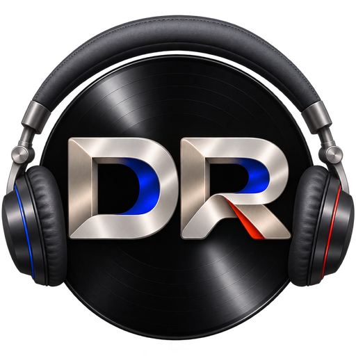

# Dr. DJ Pro

**Zwei Decks für deine eigene Musiksammlung.** Finde einen Remix am Cover wieder, markiere seinen ersten Downbeat und höre auf Deck B vor, während Deck A läuft. Dr. DJ Pro verbindet die Vorbereitung deiner Library mit einem Mixer für Maus, Tastatur oder Denon DJ MC4000. Die Desktop-App ist in Rust und Slint gebaut.

**[Vorschau herunterladen](https://github.com/yovannyr/DrDJPro/releases/tag/desktop-preview-0.1.0-rc.1)** · **[Dein erster Mix](docs/wiki/Erster-Mix.md)** · **[GitHub-Wiki](https://github.com/yovannyr/DrDJPro/wiki)** · [Handbuch im Repository](docs/wiki/Home.md) · **[Pressekit und Logo](docs/wiki/Pressekit.md)**

## Welches Paket brauche ich?

| Dein Rechner | Desktop-Vorschau 0.1.0 RC1 |
| --- | --- |
| Windows x64 | [Windows-Setup (.msi)](https://github.com/yovannyr/DrDJPro/releases/download/desktop-preview-0.1.0-rc.1/Dr-DJ-Pro-0.1.0-Windows-x64.msi) |
| Intel-Mac, macOS ab 14 | [macOS Intel (.dmg)](https://github.com/yovannyr/DrDJPro/releases/download/desktop-preview-0.1.0-rc.1/Dr-DJ-Pro-0.1.0-macOS-Intel.dmg) |
| Mac mit Apple Silicon, macOS ab 14 | [macOS Apple Silicon (.dmg)](https://github.com/yovannyr/DrDJPro/releases/download/desktop-preview-0.1.0-rc.1/Dr-DJ-Pro-0.1.0-macOS-Apple-Silicon.dmg) |
| Ubuntu 24.04 auf Intel/AMD, 64 Bit | [Ubuntu-Paket (.deb)](https://github.com/yovannyr/DrDJPro/releases/download/desktop-preview-0.1.0-rc.1/Dr-DJ-Pro-0.1.0-Ubuntu-amd64.deb) |

Der Installer braucht keine Rust-Entwicklungsumgebung. Die Windows-Vorschau ist ohne Herausgebersignatur, die Mac-Pakete sind ad hoc signiert und noch ohne Apple-Notarisierung. Die [Installationsanleitung](docs/wiki/Installation-und-Updates.md) erklärt Paketwahl, Prüfsummen und Updates.

## Vom ersten Import bis zum Übergang

| Beim Auflegen | Was du in Dr. DJ Pro tun kannst |
| --- | --- |
| Sammlung aufbauen | Dateien oder ganze Ordner importieren, Metadaten durchsuchen und sortieren, lokale Tracks aus einer iTunes-XML-Bibliothek übernehmen und verschobene Titel neu zuordnen. SQLite speichert deinen Katalog. |
| Das Set vorbereiten | Tracks in Crates sammeln, die Prep Queue für den Abend ordnen und im Verlauf gespielte Titel finden. BPM und Tonart analysieren, Beatgrids bearbeiten und Phrasenvorschläge als Hot Cues übernehmen. |
| Den Einstieg treffen | Farbige Wellenformen als Übersicht und im Detail lesen, zoomen, mit dem Jogwheel suchen oder scratchen. Pitch, Keylock und kurzzeitiger Nudge helfen beim Angleichen. Mit passenden Grids stehen Tempoabgleich, Phasenausrichtung und kontinuierlicher Sync zur Verfügung. |
| Eine Passage verlängern | Bis zu acht Hot Cues pro Deck setzen. Manuelle Loops mit In und Out bestimmen, Auto-Loops aufs Raster legen, verkürzen, verlängern und gespeicherte Loops wieder aufrufen. |
| Den Übergang spielen | Trim, Dreiband-EQ, Filter, Kanalfader und Crossfader einsetzen. Mit einem passenden Mehrkanalgerät Master und Kopfhörer getrennt ausgeben, Cue und Master im Kopfhörer mischen oder Split Cue nutzen. |
| Akzente setzen | Drei Effektslots pro Deck mit Delay, Tief- oder Hochpass bestücken. Der One-Shot-Sampler spielt bis zu vier geladene Sounds. |
| Den Arbeitsplatz einrichten | Classic und Modern nutzen dieselbe Library und dieselben spielbaren Decks A und B. Modern zeigt eingebettete Cover auf den Decks, die gemeinsame Tabelle als Miniaturen. Die Vier-Slot-Ansicht ergänzt die Anzeigeplätze C und D. |
| Hardware und zweiten Bildschirm nutzen | Der MC4000 steuert unter anderem Transport, Jogwheels, Mixer, Pads und Browse/Load. Für passende Geräte gibt es USB-Erkennung und HID-Profile. Ein separates 128 × 64-Statusfenster lässt sich auf einen zweiten Monitor ziehen. |
| Hilfe und Diagnose | Die App verwaltet Absturzberichte lokal. Du kannst einen Bericht ansehen und die Übermittlung seines Textes freigeben. Binäre Dumps bleiben lokal. |

**Welche Ansicht sehe ich?** Die veröffentlichte RC1 zeigt mehrere Direktknöpfe, etwa **AUDIO**, **iTunes** und **REPORTS**. Im aktuellen Hauptzweig öffnet das Zahnrad die fünf Bereiche **Decks**, **Audio**, **Mixer**, **Library & Ansicht** und **Controller**. Das Handbuch nennt bei verschobenen Funktionen beide Wege.

## Musikdateien und optionale Erweiterungen

MP3, WAV, FLAC, AIFF/AIF, M4A mit AAC-LC oder ALAC sowie Ogg mit Vorbis oder Opus gehören zum lokalen Ladepfad. Bei Opus werden einzelne Mono- und Stereostreams unterstützt. Der enthaltene Codec entscheidet über die Wiedergabe. Cover im JPEG- oder PNG-Format werden bei Bedarf als Miniaturen im Arbeitsspeicher gehalten. [Library und Vorbereitung](docs/wiki/Library-und-Vorbereitung.md)

Für eigene Builds gibt es modellgestütztes Beat-/Downbeat-Tracking, vorberechnete Stems und eine optionale DVS-Anbindung. Ein separates lokales Hilfsprogramm kann ähnliche Tracks und Übergänge vorschlagen oder einem MCP-Client lesenden Zugriff auf die Library geben. Der eingebettete Windows-Browser dient zum Stöbern. [Analyse und Erweiterungen](docs/wiki/Analyse-und-Erweiterungen.md) · [Controller und Anschlüsse](docs/wiki/Controller-und-Anschluesse.md)

## Mitmachen

Probier einen Übergang mit zwei Tracks aus, die du gut kennst. Funktioniert ein Ausgang, ein Controller oder ein Dateiformat anders als erwartet? Mit App-Version, Betriebssystem, Gerät und den Schritten bis zum Fehler lässt sich dein Bericht nachvollziehen. [Fehler oder Idee melden](https://github.com/yovannyr/DrDJPro/issues) · [Hilfe und Diagnose](docs/wiki/Hilfe-und-Diagnose.md)

Für Entwickler gibt es das [GUI-Inventar](docs/GUI_COMPONENTS.md) und das [Messprotokoll für große Bibliotheken](docs/LIBRARY_STORAGE.md#repeatable-native-library-performance-protocol-2026-10-30). Ein absoluter JSON-Zielpfad in `DRDJ_LIBRARY_PERF_PATH` aktiviert die Messung für einen nativen Lauf. Der Bericht entsteht beim regulären Beenden.

[Projektlizenz (MIT)](LICENSE) · [Hinweise zu Drittkomponenten](THIRD_PARTY_NOTICES.md) · 
