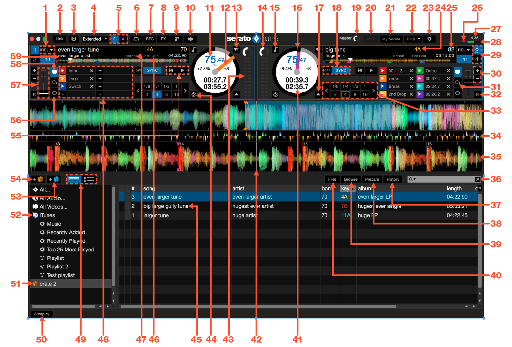
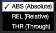
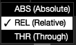
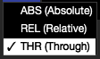
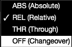
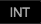
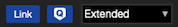
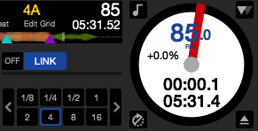
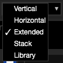
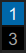

# Softwareübersicht
Die folgende Tabelle gibt einen Überblick über die DR DJ Pro Startseite. Jeder Punkt wird später in der Bedienungsanleitung im Detail betrachtet.

## 1	Playback mode
	Wählen Sie den Serato DJ Pro Wiedergabemodus für das ausgewählte Deck. Wählen Sie zwischen den Modi INT (Intern), REL (Relativ) oder ABS (Absolut). REL- und ABS-Modus sind DVS-Modi und nur verfügbar, wenn DVS im SETUP-Bildschirm aktiviert ist.
    Bei der Verwendung von DR DJ Pro mit unterstützter Hardware, die die Vinyl- oder CDJ-Steuerung ermöglicht, verfügen Sie über 4 verschiedene Betriebsarten (5, wenn Sie eine Rane SL4-Schnittstelle oder einen Rane Sixty-Eight Mixer verwenden)..

    - Absolute Mode
    Sie können den Absolute-Modus aus einem Dropdown-Menü in der oberen linken Ecke des virtuellen DeckBereichs auswählen. Der ABS-Modus ist der Standardmodus und entspricht am ehesten die Eigenschaften des regulären Vinyl. Der Beginn des Tracks ist auf den Beginn des Albums festgelegt und indem Sie den Tonarm anheben und die Nadel zu einem anderen Teil der Platte bewegen (Needle Dropping), können Sie eine andere Stelle des Tracks abspielen. Der ABS-Modus reproduziert die Bewegung der Vinyl-Aufzeichnungen, einschließlich Stopps, Starts, Scratching, Needle Dropping, Rubbing und andere Turntablist-Techniken
   

    - Relative Mode
    Sie können den Relative-Modus aus einem Dropdown-Menü in der oberen linken Ecke des virtuellen DeckBereichs auswählen. Der REL-Modus berücksichtigt die relativen Vor- und Rückwärtsbewegung der Platte, nicht jedoch die Position auf der Platte. Der REL-Modus deaktiviert Needle Dropping, ermöglicht jedoch überspringungsfreies Scratching.

    - Through Mode
    Sie können den Through-Modus aus einem Dropdown-Menü in der oberen linken Ecke des virtuellen DeckBereichs auswählen. Der THR-Modus schaltet das ausgewählte Deck auf stumm. Wenn ein Kanal auf THRU gestellt ist, wird die entsprechende virtuelle Deck-Anzeige als THRU-Modus angezeigt und Waveforms werden grau dargestellt. Audioinhalte auf diesem Kanal werden die meisten Audio-Verarbeitungseinheiten umgehen, mit Ausnahme von FX und Sampler. Der Übergang vom ABS/REL/INT-Modus zum THR-Modus pausiert den aktuellen Song auf dem entsprechenden virtuellen Deck, aber alle anderen Einstellungen (z.B. Loops, Keylock usw.) bleiben erhalten.

    THRU-Software gibt Ihnen die Möglichkeit, Effekte anzuwenden und/oder Samples in die Eingangsquelle (z. B. analoges Vinyl) einzufügen.

    - Changeover Mode
    Wenn Sie eine Rane SL4-Schnittstelle oder einen Rane Sixty-Eight Mixer verwenden, haben Sie auch die Möglichkeit AUS (Wechsel) auszuwählen.
    Sie können den Wechselmodus aus einem Dropdown-Menü in der oberen linken Ecke des virtuellen DeckBereichs auswählen. Der AUS-Modus schaltet das ausgewählte Deck auf stumm. Dies dient vor allem der Steuerung, welche Audioinhalte während eines DJ-Wechsels an den Sixty-Eight-Mixer und die SL4 Schnittstelle zum Mix geschickt werden.

    - Internal Mode
    Wenn Sie das Ende des Vinyl-oder CD-Titels entweder unter Verwendung des ABS- oder REL-Modus erreichen, schaltet Serato DJ Pro automatisch auf INT-Modus. Dies ist als Interner Notfallmodus bekannt, der verhindert, dass lange Titel stoppen, wenn Sie der Vinyl-oder CD-Titel zu Ende ist. Sie können von internen Notfallmodus, zum ABS- oder REL-Modus wechseln, indem Sie die Nadel anheben und Sie in das Lead-in der ControlVinyl platzieren. Es wird eine Sekunde dauern, bis der ABS oder REL-Modus wieder aktiviert ist. Der interne Modus wird das Tempo, dass Sie im ABS- oder REL-Modus ausgewählt hatten, beibehalten.

    Sie können die folgenden Tastenkombinationen verwenden, um schnell zwischen den Steuerarten zu
    wechseln:

    • Absolute Mode: F1 für das linke deck, F6 für das rechte deck.
    • Relative Mode: F2 für das linke deck, F7 für das rechte deck.
    • Internal Mode: F3 für das linke deck, F8 für das rechte deck.
    

TIPP: Durch die Verwendung der Steuerungstaste + F3 oder F8 wird das Deck auf Internen Modus gesetzt, Sync wird deaktiviert, das Tempo auf 0 gesetzt und “Play” aktiviert. Dies ist als “Sicherheitsmodus” bekannt.

Sie können auch auf den Sicherheitsmodus zugreifen, indem die Steuerungstaste drücken + die Schaltfläche Interner Modus in der Software anklicken.
## 2	Link	Umschaltfunktionalität.
Um Link zu aktivieren, vergewissere dich dass auf dem Bildschirm “SETUP” unter “DJ-Voreinstellungen” die Optionen “SYNC” und “Snap to Beatgrid” [Auf Beatgrid einrasten] aktiviert sind und die primäre SeratoHardware angeschlossen ist. Klicke dann oben links auf dem Serato DJ Pro-Interface auf die Schaltfläche “Link”. Die Schaltfläche “Sync” im Virtual Deck in Serato DJ Pro wird zur Schaltfläche “LINK”, wenn Link aktiviert wird.

Sobald Link aktiviert ist und eine zweite mit Link kompatible App bzw. ein zweites mit Link kompatibles Gerät zum Netzwerk stößt, wird eine Link-Sitzung gestartet.

Die erste Instanz von Serato DJ Pro (oder der anderen Link-App bzw. des anderen Link-Geräts) legt das anfängliche Tempo für andere Link-Apps oder -Geräte fest. Alle Tempoänderungen an der Sitzung werden jedoch für die gesamte Sitzung übernommen.

HINWEIS: Link kann auch mit den Sampler Slots verwendet werden. In diesem Fall werden die entsprechenden Sync-Schaltflächen dieser Sample Slots geändert.
Weitere Informationen zu Ableton Live Link findest du in den häufig gestellten Fragen auf der Website des Ableton Support Centres: https://help.ableton.com/hc/en-us
## 3	Quantize	Schaltet Quantize An/Aus
## 4	Anzeigemodi	Wählt zwischen den verfügbaren Serato DJ Pro-Anzeigemodi.

DR DJ Pro gibt Ihnen die Möglichkeit aus unterschiedlichen Anzeigemodi den auszuwählen, der zu Ihrem Performancestil passt. Die Schaltfläche für den Anzeigemodus befindet sich in der linken oberen Ecke des Hauptbildschirms.

Die verfügbaren Anzeigemodi sind:

Vertikal: Die virtuellen Decks werden auf der linken und rechten Seite des Bildschirms mit vertikalen Waveforms in der Mitte angezeigt.
Horizontal: Die virtuellen Decks werden auf der linken und rechten Seite des Bildschirms mit horizontalen Waveforms in der Mitte angezeigt.
Erweitert: Minimiert die Informationen über die virtuellen Decks mit horizontalen Waveforms über den Bildschirm.
Stapeln: Die Virtual Decks werden auf der linken Seite des Bildschirms gestapelt mit den Waveforms rechts davon. Sie können außerdem entweder ein vereinfachtes virtuelles Deck, Cue-Punkte oder Loops in einem zusätzlichen Tab sehen.
Bibliothek: Maximiert die Anzeige Ihrer Bibliothek durch weitere Minimierung der angezeigten Informationen der virtuellen Decks.
HINWEIS: Durch das Drücken der Leertaste wird vom Bibliotheksmodus zum vorher ausgewählten Anzeigemodus umgeschaltet.

Wenn nicht ausreichend Platz auf dem Bildschirm vorhanden ist, um alle offenen Felder anzuzeigen (z. B.  DJ-FX und das Dateifeld), passt sich der Bildschirm möglicherweise an und zeigt die zuletzt geöffneten Felder. In der Statusleiste wird eine Meldung angezeigt, wenn dies geschieht.

 Durch das Auswählen von 2 Decks werden die beiden aktiven Decks wie angezeigt durch einen blauen Rahmen dargestellt. Wenn Sie eine Rane SL3-Schnittstelle verwenden, kann das linke Deck entweder als Deck 1 oder Deck 3 ausgewählt werden . Sie müssen die Stapel-Anzeige verwenden, um alle drei Decks gleichzeitig zu sehen.

HINWEIS: Die aktiven Decks werden durch einen blauen Rahmen hervorgehoben.
## 5	Deckmodi	Klicken Sie hier, um zwischen den Deck-Modi zu wechseln, abhängig von Ihrer angeschlossenen Hardware. Ohne
angeschlossene Hardware, schaltet zwischen Offline- und Übungsmodus um.
SIEHE PRACTICE MODE FÜR WEITERE INFORMATIONEN
## 6 	Flip Panel	Klicken Sie auf, um das Fenster “Flip Recording” zu öffnen.
SIEHE SERATO FLIP FÜR WEITERE INFORMATIONEN
## 7 	Record	Klicken Sie auf, um das Aufzeichnungsfenster zu öffnen.
SIEHE RECORDING FÜR WEITERE INFORMATIONEN
## 8 	DJ-FX-Steuerung	 Klicken Sie hier zum Öffnen der DJ-FX-Steuerung.
WEITERE INFORMATIONEN FINDEN SIE UNTER DJ-FX
## 9 	Steuerung des
Sampler Sample
Players	 Klicken Sie hier, um die Steuerung des SP6 Sample Players zu öffnen.
WEITERE INFORMATIONEN FINDEN SIE UNTER SAMPLER
## 10 	Serato Video	 Klicken Sie hier, um den Serato Video Expansion Pack öffnen.
WEITERE INFORMATIONEN FINDEN SIE UNTER SERATO VIDEO
## 11	Aktuelle BPM	Zeigt das Tempo des aktuellen Tracks in Beats pro Minute an.
## 12	Platter position
indicator	Zeigt die Beziehung des virtuellen Decks zur Position des physischen Plättchens an. Eine volle Umdrehung entspricht einer vollen Umdrehung der Platte.
## 13	Slip-Modus	Slip-Modus aktivieren.
## 14	Trackgain
einstellen	Hier können Sie den individuellen Trackgain für den aktuell geladenen Track einstellen. Anpassungen des
Trackgains werden in der Datei gespeichert und beim nächsten Laden des Tracks abgerufen.
## 15	Keylock	Die Aktivierung der Keylock-Funktion bedeutet, dass der Song seine Taste behält, wenn das Tempo des Songs geändert wird.
## 16	Virtuelles Deck	Zeigt Titelinformationen an.
## 17	Eject	Werfen Sie einen Track von einem geladenen virtuellen Deck aus.
## 18	Sync	Aktiviert oder deaktiviert die Sync-Funktion. Status wird am Deck blau für Beat Sync, gold für Tempo Sync und grau für Arm Beat Sync angezeigt.
## 19	Master-Ausgangspegel-Einstellung.	Hier können Sie den Master-Ausgangspegel einstellen.
## 20	MIDI	Aktiviert den MIDI Zuweise modus.
WEITERE INFORMATIONEN FINDEN SIE IN DER MIDI-STEUERUNG.
## 21	My Serato	Klicken Sie, um das My Serato Panel zu starten.
## 22	Help	Greifen Sie auf “Tooltips anzeigen”, “Tastenkombinationen anzeigen”, “Tutorials ansehen” und “Support abrufen” zu.
WEITERE INFORMATIONEN FINDEN SIE UNTER ERSTE SCHRITTE
## 23	Setup	Zeigt den Software-Setup-Bildschirm an.
## 24	Musical Key	Zeigt den Schlüssel des aktuell geladenen Titels an. Key-Tag-Informationen können manuell in der Spalte “KeyBibliothek” eingegeben oder automatisch erkannt werden, wenn die Track-Analyse im Menü “Analyseeinstellungen” aktiviert ist.
## 25	Original BPM	Zeigt das Original-BPM einer ordnungsgemäß analysierten Spur an, unabhängig von der vorgenommenen Tonhöhenanpassung.
## 26	Audio drop-out
warning light	Zeigt ein farbiges Warnlicht an, das anzeigt, dass die Wahrscheinlichkeit eines Audioausfalls erhöht ist
## 27	Current time	Zeigt die aktuelle Uhrzeit an.
## 28	CPU meter	Zeigt die aktuelle Computer-CPU-Verarbeitung Last an.
## 29	Virtual deck toggle	Zeigt die Nummer für dieses virtuelle Deck an. Klicken Sie, um zwischen 1 und 3 oder 2 und 4 zu wechseln, falls verfügbar.
## 30 	Bend/Nudge +/-	Klicken Sie hier, um das Tempo vorübergehend zu ändern, indem Sie den geladenen Titel in der Zeit vor- oder zurückspulen.
## 31 	Flip tab	Zeigt bis zu 6 gespeicherte Flip-Sequenzen an.
## 32 	Tempo range	Klicken Sie hier, um den aktuell ausgewählten Tempobereich im virtuellen Deck zu ändern. Je nach Hardware sind entweder +/- 8%, +/- 16% und +/- 50% verfügbar.
## 33	Auto Loop Tab	Zeigt Loop-Informationen an, mit denen Sie Loops erstellen, ändern, speichern und löschen können.
## 34	Beat Matching
Display	Betont die Beats in der Titel.
SIEHE BEAT MATCHING DISPLAY FÜR WEITERE INFORMATIONEN
## 35	Waveform	Farbige Wellenform der aktuell geladenen Spur zur Darstellung der Frequenzen des Klangs.
## 36 	Search	Durchsucht Ihre Bibliothek oder Crate nach dem in diesem Feld eingegebenen Text.
## 37 	History	Zeigt das Bedienfeld Verlauf mit bereits gespielten Titeln an.
## 38 	Prepare 	Zeigt das Vorbereitungsfenster an, das die Titel enthält, die Sie für Ihr Set ausgewählt haben.
## 39 	Browse 	Zeigt das Durchsuchenbedienfeld an, in dem Sie nach Titeln nach Genre, BPM usw. suchen können.
## 40 	Files 	Zeigt das Bedienfeld Dateien an, in dem Sie nach Titeln auf Ihrer Festplatte suchen können.
## 41 	 Time Elapsed /
Time Remaining	Zeigt die aktuelle und die verbleibende Zeit für den geladenen Track an.
## 42 	 Playhead	Zeigt die Abspielposition in der Wellenform übersicht der Spur an
## 43 	Track Output level meter	Ermöglicht die visuelle Überwachung der einzelnen Deck ausgänge.
## 44 	Censor	Kehrt die Spur um, während sie gedrückt wird. Wenn Censor freigegeben wird, wird die Spur fortgesetzt, als ob
kein Zensor gedrückt worden wäre.
## 45 	Bibliothek	Zeigt die in Ihrer aktuellen Bibliothek verfügbaren Songs an
## 46 	Edit Grid	Klicken Sie auf, um Beatgrid-Modus bearbeiten zu aktivieren.
## 47 	Repeat	Wenn Repeat aktiviert ist, spielt Serato DJ Pro den geladenen Track nach dem Start erneut von Anfang an ab
## 48 	Cue Point area	Zeigt Cue-Point-Trigger an.
## 49 	Library Display
modes	Wählen Sie zwischen den Anzeigemodi Einfache Liste und Album Art Grid.
SIEHE BIBLIOTHEK MODI FÜR WEITERE INFORMATIONEN
## 50 	Autoplay	Wenn die automatische Wiedergabe aktiviert ist, lädt und spielt Serato DJ Pro automatisch den nächsten
verfügbaren Titel von der aktuell ausgewählten Kiste, sobald der aktuell abgespielte Titel endet.
## 51 	Crates	Zeigt eine Liste der verfügbaren Kisten, Unter kisten und Smart-Kisten an.
## 52 	iTunes	Zeigt Tracks, die über iTunes in Serato geladen wurden.
SIEHE ANZEIGEN IHRER ITUNES-BIBLIOTHEK FÜR WEITERE INFORMATIONEN
## 53	Add Smartcrate	Fügt einen neuen Smart Crate hinzu, der automatisch basierend auf Regeln auffüllt.
SIEHE SMART CRATES FÜR WEITERE INFORMATIONEN
## 54	Add Crate	Fügt eine neue Kiste hinzu, damit Sie Ihre Dateien organisieren können.
SIEHE CRATES FÜR WEITERE INFORMATIONEN
## 55	Playback controls	Damit können Sie den geladenen Titel wiedergeben, zum nächsten Titel springen, zum Anfang des geladenen
Titels springen oder den vorherigen Titel laden.
## 56	Loops tab	Zeigt bis zu 8 gespeicherte Loops pro Spur an.
SIEHE LOOPING FÜR WEITERE INFORMATIONEN
## 57	Tempo slider	Verwenden Sie den Tempo-Schieberegler, um Tempo einstellungen vorzunehmen
## 58	Cue Point tab	Zeigt bis zu 8 Cue-Punkte pro Spur an.
SIEHE CUE-PUNKTE FÜR WEITERE INFORMATIONEN
## 59	Track Display	Zeigt den Songtitel und die Interpreten informationen für den aktuell auf dem Deck geladenen Track an.