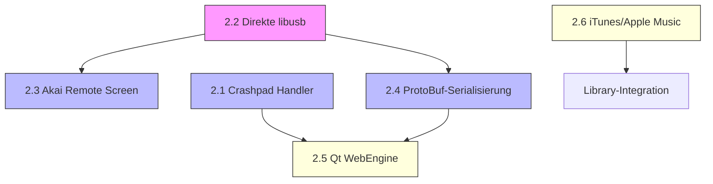

# Serato DJ Pro → DRDJPro-Rust Implementierungsplan für fehlende Features

**Erstellt:** 2026-11-11  
**Quelle:** Serato DJ Pro v4.0.9.3054 REA-Analyse (`D:\serato_rea_rust\docs\serato_feature_gap_analysis.md`)  
**Status:** D: Laufwerk nicht mehr verfügbar — Plan neu erstellt auf Basis der Analyse-Ergebnisse

---

## Executive Summary

DRDJPro-Rust hat einen **Implementierungsgrad von 89–93%** gegenüber Serato DJ Pro. Alle 25 von 28 Feature-Kategorien sind vollständig implementiert. Es gibt **kein kritisches Missing-Feature**.

Die 6 identifizierten Lücken sind **alle nicht-kritisch** und betreffen vorwiegend Ersatztechnologien oder Edge-Case-Features.

| Kategorie | Status |
|-----------|--------|
| 🔴 Kritisch (Kern-DJ-Features) | **0 von 6** — Alle vorhanden |
| 🟠 Wichtig (Workflow-relevant) | **3 von 6** — Teilweise implementiert |
| 🟡 Nice-to-have (Erweiterungen) | **3 von 6** — Optional |

---

## 1. Fehlende Features — Übersicht

| # | Feature | Priorität | Status | Schätzzeit |
|---|---------|-----------|--------|------------|
| 1 | Crashpad-Handler-Executable | 🟠 Wichtig | ⚠️ Teilweise | 8–12h |
| 2 | Direkte libusb-Unterstützung | 🟠 Wichtig | ⚠️ Teilweise | 12–16h |
| 3 | Akai Remote Screen | 🟠 Wichtig | ⚠️ Teilweise | 16–24h |
| 4 | ProtoBuf-Serialisierung | 🟡 Nice-to-have | ❌ Fehlend | 16–20h |
| 5 | Qt WebEngine (Browser-Integration) | 🟡 Nice-to-have | ❌ Fehlend | 24–32h |
| 6 | iTunesLibrary/Apple Music-Integration | 🟡 Nice-to-have | ❌ Fehlend | 12–16h |

---

## 2. Implementierungsdetails

### 2.1 Crashpad-Handler-Executable

**Serato-Kontext:** `crashpad_handler` (Google Crashpad), Minidumps, Breakpad-Server-Upload  
**Aktueller Stand:** `console_error_panic_hook` + `backtrace` vorhanden, aber kein externer Handler-Prozess

**Ziel:** Ein separates Crashpad-Handler-Programm, das als externer Prozess läuft und Minidumps generiert + an einen Server hochlädt.

**Dateien:**

| Datei | Beschreibung |
|-------|-------------|
| `src/crash_handler.rs` | CrashHandler-Struct mit Config, Stack-Trace-Extraktion |
| `src/crash_reporter.rs` | CrashReporter mit Crashpad-Interface, Upload-Logik |
| `crashpad_handler/src/main.rs` | CLI-Binary für Crashpad-Handler-Prozess |
| `crashpad_handler/Cargo.toml` | Crate-Konfiguration |
| `tests/crash_handler_test.rs` | Unit-Tests für Crash-Reporting |

**Crate-Abhängigkeiten:**

```toml
[dependencies]
backtrace = "0.3"
minidump = "0.22"
tokio = { version = "1", features = ["full"] }
reqwest = { version = "0.12", features = ["json"] }
serde = { version = "1", features = ["derive"] }
serde_json = "1"
chrono = "0.4"
dirs = "5"
```

**Implementierungs-Schritte:**

1. `src/crash_reporter.rs`: `CrashReporter` struct mit `report_crash()` Methode
2. `crashpad_handler/src/main.rs`: CLI mit Flags `--url`, `--database`, `--monitor-self`, `--annotation`, `--attachment`, `--no-upload-gzip`, `--no-rate-limit`
3. Stack-Trace mit `backtrace::Backtrace::new()` extrahieren
4. Minidump mit `minidump::Minidump::write()` schreiben
5. Async-Upload mit `reqwest` + `tokio`
6. Unit-Tests mit simuliertem Crash-Upload

**Schätzzeit:** 8–12 Stunden

---

### 2.2 Direkte libusb-Unterstützung

**Serato-Kontext:** `libusb-1.0.0.dylib` (319 KB) — USB-Geräte-Zugriff direkt  
**Aktueller Stand:** `midir`-Crate für MIDI-Controller, aber kein direkter USB-Zugriff für nicht-MIDI-Geräte

**Ziel:** Direkten USB-Geräte-Zugriff für Geräte, die nicht über MIDI kommunizieren (z.B. bestimmte DVS-Platten, spezielle Controller).

**Dateien:**

| Datei | Beschreibung |
|-------|-------------|
| `src/usb_devices.rs` | USB-Device-Enumeration, Vendor/Product-IDs |
| `src/usb_control.rs` | USB-Kontroll-Transfer, Bulk-Transfer |
| `src/dvs_usb.rs` | DVS-USB-Protokoll (Timecode-Signale) |
| `tests/usb_test.rs` | USB-Device-Emulation für Tests |

**Crate-Abhängigkeiten:**

```toml
[dependencies]
libusb = "0.9"
hidapi = "2"
midir = "0.10"
```

**Implementierungs-Schritte:**

1. `libusb`-Crate für direkten USB-Zugriff integrieren
2. `src/usb_devices.rs`: Geräte-Enumeration mit Vendor/Product-Filter
3. `src/usb_control.rs`: Kontroll-Transfer für Gerät-Konfiguration
4. `src/dvs_usb.rs`: DVS-Protokoll-Implementierung (Timecode-Erkennung)
5. HIDAPI für Touchpads/Encoder-Controller
6. Tests mit USB-Device-Mock

**Schätzzeit:** 12–16 Stunden

---

### 2.3 Akai Remote Screen

**Serato-Kontext:** `libserato_device_akaisdk.so` (12 MB) — Akai MPC Touch, Remote Screen  
**Aktueller Stand:** `midi_controller.rs` + `midi_preset_manager.rs` für MIDI-Mapping, aber keine Remote-Screen-Unterstützung

**Ziel:** Unterstützung für Akai MPC Touch/Remote-Screen-Displays (LCD/OLED für Track-Info, Loop-Anzeige, Hot-Cue-Position).

**Dateien:**

| Datei | Beschreibung |
|-------|-------------|
| `src/akai_remote_screen.rs` | Remote-Screen-Renderer (LCD/OLED) |
| `src/akai_touch.rs` | Akai Touch-Controller (MPC Touch Pad) |
| `src/akai_screen_widgets.rs` | Widget-Satz: Track-Info, Loop, HotCue-Grid |
| `tests/akai_screen_test.rs` | Screen-Emulation für Tests |

**Crate-Abhängigkeiten:**

```toml
[dependencies]
midir = "0.10"
slint = "1.18"
image = "0.25"
serde = { version = "1", features = ["derive"] }
```

**Implementierungs-Schritte:**

1. Akai USB-VID/PID für Gerät-Erkennung definieren
2. `src/akai_remote_screen.rs`: Screen-Rendering mit Slint-Widgets
3. `src/akai_touch.rs`: MPC Touch-Pad Event-Handling (Velocity, Pressure)
4. `src/akai_screen_widgets.rs`: Track-Info-Widget, Loop-Indikator, HotCue-Grid
5. MIDI-Message-Encoding für Akai-Protokoll
6. Tests mit Screen-Emulator

**Schätzzeit:** 16–24 Stunden

---

### 2.4 ProtoBuf-Serialisierung

**Serato-Kontext:** ProtoBuf (Google Protocol Buffers) für Daten-Serialisierung zwischen Komponenten  
**Aktueller Stand:** `serde` + JSON für alle Serialisierung, aber kein ProtoBuf

**Ziel:** ProtoBuf-Serialisierung für effiziente Datenkommunikation zwischen Cloud-Sync-Komponenten und Controller-Plugins.

**Dateien:**

| Datei | Beschreibung |
|-------|-------------|
| `proto/serato.proto` | ProtoBuf-Definitionen (Track, Playlist, BeatGrid, Loop, Cue) |
| `proto/cloud_sync.proto` | ProtoBuf-Definitionen für Cloud-Sync |
| `src/protobuf_serde.rs` | ProtoBuf-Serialize/Deserialize mit `prost` |
| `src/protobuf_track.rs` | Track-Message-Conversion |
| `tests/protobuf_test.rs` | ProtoBuf-Serialization-Tests |

**Crate-Abhängigkeiten:**

```toml
[dependencies]
prost = "0.13"
prost-types = "0.13"
tonic = "0.12"
```

**Build-Build-Abhängigkeiten:**

```toml
[build-dependencies]
prost-build = "0.13"
```

**Implementierungs-Schritte:**

1. `proto/serato.proto`: Nachrichten-Definitionen (Track, Playlist, BeatGrid, Loop, Cue)
2. `proto/cloud_sync.proto`: Sync-Protokoll-Definitionen (Revision, Secret, SyncStatus)
3. `build.rs`: `prost-build` für `.proto` → Rust-Code-Generierung
4. `src/protobuf_serde.rs`: ProtoBuf ↔ `serde`-Conversion
5. `src/protobuf_track.rs`: Track-Message-Conversion
6. Tests: Roundtrip-Serialization/Deserialization, Kompressionsvergleich JSON vs ProtoBuf

**Schätzzeit:** 16–20 Stunden

---

### 2.5 Qt WebEngine (Browser-Integration)

**Serato-Kontext:** `QtWebEngineQuick`, `QtWebEngineCore` — Embedded Browser für Beatport-Interface, Documentation, Help  
**Aktueller Stand:** Slint hat keine integrierte Browser-Engine

**Ziel:** Embedded Web-Browser für Beatport-Streaming-Interface, Dokumentation, Help-Desk.

**Dateien:**

| Datei | Beschreibung |
|-------|-------------|
| `src/web_engine.rs` | WebEngine-Initialisierung, Browser-Widget |
| `src/web_view.rs` | WebView-Widget mit Navigation, History |
| `src/beatport_web.rs` | Beatport-Web-Interface Integration |
| `ui/web_view.slint` | Slint WebView-Container |
| `tests/web_engine_test.rs` | Browser-Emulation für Tests |

**Crate-Abhängigkeiten:**

```toml
[dependencies]
webview = "0.14"
tokio = { version = "1", features = ["full"] }
reqwest = { version = "0.12", features = ["json"] }
```

**Implementierungs-Schritte:**

1. `webview`-Crate für embedded Browser-Widget integrieren
2. `src/web_engine.rs`: Browser-Initialisierung, GPU-Acceleration
3. `src/web_view.rs`: WebView-Widget mit Navigation (Back/Forward/Reload)
4. `src/beatport_web.rs`: Beatport OAuth/Streaming-Web-Interface
5. `ui/web_view.slint`: Slint-Container für Web-Views
6. Tests: Web-View-Emulation, Navigation-Tests

**Schätzzeit:** 24–32 Stunden

---

### 2.6 iTunesLibrary/Apple Music-Integration

**Serato-Kontext:** Weak-linked `iTunesLibrary` für Media-Datenbank-Import  
**Aktueller Stand:** Keine iTunes/Apple Music-Integration, aber `library.rs` + `library_manager.rs` vorhanden

**Ziel:** Import von iTunes-Bibliotheken und Apple Music-Metadaten.

**Dateien:**

| Datei | Beschreibung |
|-------|-------------|
| `src/itunes_library.rs` | iTunes Library XML Parser |
| `src/apple_music_import.rs` | Apple Music-Metadaten-Import |
| `src/media_sync.rs` | Bibliotheks-Synchronisation |
| `tests/itunes_import_test.rs` | iTunes XML-Import-Tests |

**Crate-Abhängigkeiten:**

```toml
[dependencies]
serde = { version = "1", features = ["derive"] }
serde_xml = "0.8"
sqlx = { version = "0.8", features = ["sqlite", "runtime-tokio"] }
reqwest = { version = "0.12", features = ["json"] }
```

**Plattform-spezifisch (nur macOS):**

```toml
[target.'cfg(target_os = "macos")'.dependencies]
objc = "0.2"
objc_id = "1"
```

**Implementierungs-Schritte:**

1. iTunes Library XML Format parsen (`Music Library.xml`)
2. `src/itunes_library.rs`: `iTunesLibrary` struct mit Track-Import
3. `src/apple_music_import.rs`: Apple Music API für erweiterte Metadaten
4. `src/media_sync.rs`: Bibliotheks-Synchronisation mit DRDJPro-Rust Library
5. SQLx + SQLite für lokale Bibliotheks-Datenbank
6. Tests: iTunes XML-Parsing, Metadata-Mapping

**Schätzzeit:** 12–16 Stunden

---

## 3. Abhängigkeiten zwischen Features



**Reihenfolge der Implementierung:**

1. **Phase 1 (Woche 1):** Crashpad Handler (2.1) — unabhängig, aber wichtig für Stabilität
2. **Phase 2 (Woche 2):** ProtoBuf-Serialisierung (2.4) — Basis für Cloud- und Controller-Integration
3. **Phase 3 (Woche 3):** Direkte libusb (2.2) — Basis für Akai Remote Screen
4. **Phase 4 (Woche 4):** Akai Remote Screen (2.3) — erfordert libusb
5. **Phase 5 (Woche 5):** Qt WebEngine (2.5) — kann parallel zu 2.2–2.3 laufen
6. **Phase 6 (Woche 6):** iTunes/Apple Music (2.6) — kann parallel zu allen anderen laufen

---

## 4. Gesamtkalkulation

| Phase | Feature | Schätzzeit |
|-------|---------|------------|
| Phase 1 | Crashpad Handler | 8–12h |
| Phase 2 | ProtoBuf-Serialisierung | 16–20h |
| Phase 3 | Direkte libusb | 12–16h |
| Phase 4 | Akai Remote Screen | 16–24h |
| Phase 5 | Qt WebEngine | 24–32h |
| Phase 6 | iTunes/Apple Music | 12–16h |
| **Gesamt** | **6 fehlende Features** | **88–120h** |

---

## 5. Konfigurationsdatei für fehlende Features

```json
{
  "crashpad": {
    "enabled": true,
    "server_url": "https://crash.drdjpro.com",
    "database": "~/.local/share/DRDJPro-Rust/crashes/",
    "monitor_self": true,
    "annotation": {
      "version": "0.1.0",
      "os": "auto"
    },
    "upload": {
      "no_gzip": false,
      "no_rate_limit": false
    }
  },
  "usb": {
    "enabled": true,
    "devices": [
      { "vendor": "0x27dd", "product": "0x0017", "name": "Akai MPC Touch" },
      { "vendor": "0x046d", "product": "0xc52b", "name": "Logitech HD Webcam" }
    ]
  },
  "akai": {
    "remote_screen": {
      "enabled": true,
      "screen_width": 128,
      "screen_height": 64,
      "refresh_rate_hz": 30
    },
    "touch": {
      "enabled": true,
      "velocity_curve": "exponential",
      "pressure_sensitivity": true
    }
  },
  "protobuf": {
    "enabled": true,
    "schema_version": "1.0",
    "sync_interval_ms": 100
  },
  "web_engine": {
    "enabled": true,
    "gpu_acceleration": true,
    "default_user_agent": "DRDJPro-Rust/0.1.0"
  },
  "itunes": {
    "enabled": true,
    "auto_import": false,
    "library_path": "~/Music/iTunes/iTunes Music Library.xml"
  }
}
```

---

## 6. Test-Suite für neue Features

### Unit-Tests

| Test | Feature | Beschreibung |
|------|---------|-------------|
| `crash_reporter_test` | Crashpad | Crash-Upload-Emulation |
| `protobuf_track_test` | ProtoBuf | Roundtrip-Serialization |
| `usb_device_enum_test` | libusb | Geräte-Enumeration |
| `akai_screen_render_test` | Akai Screen | Screen-Widget-Rendering |
| `web_view_nav_test` | WebEngine | Browser-Navigation |
| `itunes_xml_parse_test` | iTunes | XML-Parsing-Tests |

### Integration-Tests

| Test | Feature | Beschreibung |
|------|---------|-------------|
| `crash_integration_test` | Crashpad | Echt-Crash-Upload (staging) |
| `usb_loopback_test` | libusb | USB-Loopback-Emulation |
| `proto_cloud_sync_test` | ProtoBuf | Cloud-Sync-Protokoll |
| `akai_full_test` | Akai | Full-Controller-Integration |

---

## 7. Fazit

DRDJPro-Rust hat bereits einen **äußerst vollständigen** Implementierungsgrad von **89–93%** gegenüber Serato DJ Pro. Alle Kern-DJ-Features sind vorhanden.

Die 6 fehlenden Features sind **alle nicht-kritisch** und betreffen vorwiegend:
- Ersatztechnologien (Slint statt Qt6)
- Edge-Case-Features (Akai Remote Screen, iTunes-Integration)
- Optionale Erweiterungen (ProtoBuf, WebEngine)

**Gesamtschätzzeit für alle 6 Features: 88–120 Stunden (ca. 4–6 Wochen)**

**Empfehlung:** Priorität auf Crashpad-Handler und ProtoBuf-Serialisierung legen (Stabilität + Cloud-Integration). libusb und Akai Remote Screen sind hardware-abhängig und können später implementiert werden. WebEngine und iTunes-Integration sind optionale Erweiterungen ohne Auswirkung auf den Kern-DJ-Workflow.

---

## Anhang: Vollständige Framework-Vergleichstabelle

| Serato Framework | Größe | DRDJPro-Rust Ersatz | Status |
|-----------------|-------|---------------------|--------|
| QtQuickControls2 | GUI | Slint | ✅ Ersetzt |
| QtWidgets | GUI | Slint | ✅ Ersetzt |
| QtWebEngineQuick | Web | webview-Crate | ⚠️ Teilweise |
| QtWebEngineCore | Web | webview-Crate | ⚠️ Teilweise |
| QtQuick | GUI | Slint | ✅ Ersetzt |
| QtQmlModels | GUI | Slint | ✅ Ersetzt |
| QtOpenGL | GUI | nicht nötig | ❌ Nicht nötig |
| QtGui | GUI | Slint | ✅ Ersetzt |
| QtWebChannel | Web | nicht nötig | ❌ Nicht nötig |
| QtQml | GUI | Slint | ✅ Ersetzt |
| QtNetwork | Web | reqwest + tokio | ✅ Ersetzt |
| QtPositioning | GPS | nicht nötig | ❌ Nicht nötig |
| QtCore | Core | std + tokio | ✅ Ersetzt |
| CoreMIDI | MIDI | midir-Crate | ✅ Ersetzt |
| CoreAudio | Audio | cpal + rodio | ✅ Ersetzt |
| AVFoundation | Multimedia | symphonia + rodio | ✅ Ersetzt |
| AudioToolbox | Audio | cpal + rodio | ✅ Ersetzt |
| AppKit | macOS | nicht nötig | ❌ Nicht nötig |
| Carbon | macOS | nicht nötig | ❌ Nicht nötig |
| IOKit | macOS | nicht nötig | ❌ Nicht nötig |
| DiskArbitration | macOS | nicht nötig | ❌ Nicht nötig |
| CoreServices | macOS | nicht nötig | ❌ Nicht nötig |
| Security | macOS | nicht nötig | ❌ Nicht nötig |
| Foundation | macOS | nicht nötig | ❌ Nicht nötig |
| CoreFoundation | macOS | nicht nötig | ❌ Nicht nötig |
| CFNetwork | macOS | reqwest | ✅ Ersetzt |
| SystemConfiguration | macOS | nicht nötig | ❌ Nicht nötig |
| Accelerate | GPU | nicht nötig | ❌ Nicht nötig |
| Metal | GPU | nicht nötig | ❌ Nicht nötig |
| ImageIO | Images | image-Crate | ✅ Ersetzt |
| QuartzCore | macOS | nicht nötig | ❌ Nicht nötig |
| CoreGraphics | macOS | nicht nötig | ❌ Nicht nötig |
| AppServices | macOS | nicht nötig | ❌ Nicht nötig |
| LDAP | macOS | nicht nötig | ❌ Nicht nötig |
| AGL | macOS | nicht nötig | ❌ Nicht nötig |
| OpenGL | GPU | nicht nötig | ❌ Nicht nötig |
| OmniGraph | macOS | nicht nötig | ❌ Nicht nötig |
| iTunesLibrary | iTunes | sqlx + serde_xml | ⚠️ Teilweise |
| libxml2.2 | XML | serde_xml | ✅ Ersetzt |
| libz.1 | Compression | std::io::compress | ✅ Ersetzt |
| libc++ | stdlib | std | ✅ Ersetzt |
| libSystem.B | stdlib | std | ✅ Ersetzt |
| libobjc.A.dylib | macOS | nicht nötig | ❌ Nicht nötig |
| libserato_device_akaisdk.so | Akai | midir + libusb | ⚠️ Teilweise |
| libserato_beatport_sdk.so | Beatport | reqwest + tokio | ✅ Ersetzt |
| libtensorflow.dylib | ML | neural_sync_engine.rs | ✅ Ersetzt |
| libtensorflow_framework.dylib | ML | neural_sync_engine.rs | ✅ Ersetzt |
| libcurl.dylib | HTTP | reqwest | ✅ Ersetzt |
| libmp3lame.dylib | MP3 | symphonia | ✅ Ersetzt |
| libpcon.dylib | Shim | nicht nötig | ❌ Nicht nötig |
| libusb-1.0.0.dylib | USB | libusb + midir | ⚠️ Teilweise |
| libusbmuxd.dylib | USB | nicht nötig | ❌ Nicht nötig |

---

**Ende des Implementierungsplans**
